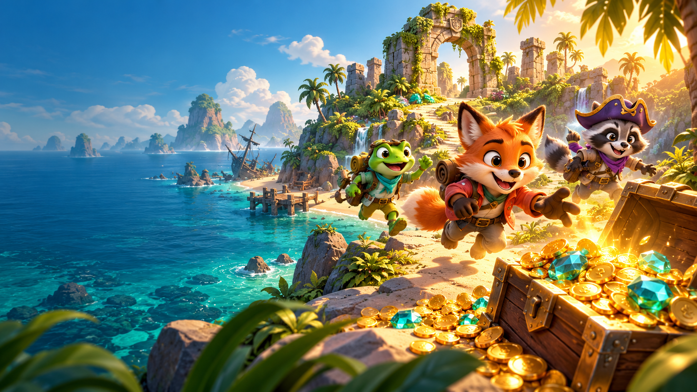

# Treasure Rush 2.1 — Sunstone Expedition

**Every second is gold.** A real-time browser treasure hunt for 2–6 friends. Create a room, share a six-character code, choose an explorer, and compete across Sunstone Island in a three-minute rush. No player login or installation required.

**Existing live version:** https://treasure-rush-i2co.onrender.com/

**V2.1 status:** this update is tested locally. Upload it and redeploy Render to publish these changes. See [the upgrade guide](docs/V21-UPGRADE.md).

**GitHub:** https://github.com/rajakotid007/treasure-rush

The active Render project directory in GitHub is `TreasureRush-V2/treasure-rush-source/treasure-rush`. Run the commands below from that project directory.



## Run locally

Requires Node.js 22+ (tested with 24.21) and npm. Open a terminal in this folder:

```sh
npm ci
npm run dev
```

Open http://localhost:3000 in two separate tabs or browsers. Create a room in the first and join using its code in the second. Each tab has its own player session. Mark both players ready; the captain starts. For friends on your Wi-Fi, open `http://YOUR-COMPUTER-LAN-IP:3000` and allow the Node service through your local firewall if prompted. All devices must reach the same server.

Development compiles the server before starting and uses Vite for frontend changes. Restart `npm run dev` after backend edits. If the environment restricts Vite's dependency optimizer, use the built preview below.

```sh
npm run build
# macOS / Linux
NODE_ENV=production npm start
# Windows PowerShell
$env:NODE_ENV='production'
npm start
```

## Play

- Keyboard: WASD or arrows to move; hold Space near a chest to dig.
- Mobile: hold directional buttons; hold DIG near a chest. Use two fingers to combine directions.
- Coins: 10 points. Diamonds: 35. Mystery chests: 50, 75, or 100, chosen on the server.
- Hidden chests appear when an explorer comes within 150 pixels; dig within 65 pixels. Stand still and hold DIG for 1 second for a chest, or 1.6 seconds for a relic. Release DIG between chests; moving or releasing cancels progress. Other pickups collect within 30 pixels.
- First-time players see a short controls guide in the lobby before marking ready.
- Stay on land: the ocean blocks movement. Marked waterfall boundaries block movement and cost up to 25 points, with a 2-second damage cooldown; a shield blocks one hit.
- Traps subtract up to 20 points and stun for 0.65 seconds, with a 1.8-second trap cooldown.
- Boots increase movement from 210 to 300 pixels/second for 6 seconds. Shields block one trap and expire after 12 seconds.
- Complete three contracts once each: 8 coins (+80), 4 diamonds (+120), 2 chests (+150).
- Collect a pearl for 60 points. During Gold Rush, coins double; during Final Fortune, diamonds and pearls double.
- Chain scoring pickups within 3.5 seconds for a multiplier up to ×1.75.
- Press Q/Shift or touch DASH for a 0.45-second speed burst; it recharges after 8 seconds.
- Magnets collect treasure within 105 pixels for 8 seconds.
- A moving storm can cost 15 points. A Sun Relic appears at the central shrine later in the round, worth 200 points. Shields block either a trap or storm hit.
- Coins, gems and power-ups respawn after 22 seconds. Chests can be claimed once per match.
- Highest score at three minutes wins. Ties share victory. The captain can return everyone to the lobby for a rematch.

Characters are cosmetic and have identical base abilities. Each is exclusive within a room. A disconnected player's reservation lasts 45 seconds. Refresh the same tab to reconnect with the original score. If a captain disconnects, captaincy moves to a connected player.

## What is implemented

React menus and HUD; Phaser mountain island with illustrated animated character sprites; six player room management; keyboard and mobile controls; authoritative movement, collision and rewards; mystery chests, traps, power-ups and mission; live scores and timer; shared result screen; reconnect and rematch; validated, rate-limited Socket.IO events; optional PostgreSQL result persistence; optional AI flavor and a development planning workflow; deployment configurations and automated multiplayer tests.

The expanded 2560 × 1600 world uses a follow camera and minimap. Ocean ambience and reward sounds are available through an opt-in sound toggle. UI fonts and game artwork are bundled locally.

The game requires an actual server. There are no simulated opponents, localStorage score simulations, or client-selected rewards.

## Verification

```sh
npm run typecheck
npm test
npm run build
npm run test:e2e
```

The Playwright configuration uses installed Google Chrome. If Chrome is unavailable, install Playwright Chromium (`npx playwright install chromium`) and set `PW_CHANNEL=chromium` before running tests. Playwright tests run against built frontend assets and the real Node server, using shortened test-only matches. Production refuses `TEST_MATCH_MS`.

See [testing documentation](docs/TESTING.md) for the observed results and limits. See [architecture and phased plan](docs/ARCHITECTURE.md), [Render and Netlify setup](docs/DEPLOYMENT.md), [AI agents](docs/AI-ARCHITECTURE.md), and [submission copy](docs/SUBMISSION.md).

## Optional database and AI

Copy `.env.example` to `.env` if you need configuration. Never commit `.env`.

- Set `DATABASE_URL` to a PostgreSQL database. The server creates a `matches` table and saves completed round rankings using parameterized SQL. Live state stays in memory. Without a database, gameplay works and completed results are not retained after server shutdown. Use the database provider's TLS instructions; certificate checks are never disabled in code.
- For optional AI flavor, set `AI_ENABLED=true` and `OPENAI_API_KEY` on the server. `OPENAI_CONTENT_MODEL` defaults to `gpt-6-luna`. A single bounded Responses API call is cached across rooms; failures use a built-in clue. No keys enter the frontend.
- `npm run ai:plan -- "Review our reconnection strategy"` runs the optional Agents SDK development planning workflow. This does not change files, execute tests, or deploy anything. No paid calls are required to play.

## V1 deployment history

Deployed on Render at https://treasure-rush-i2co.onrender.com/. The built service passed a public health and six-WebSocket-client smoke test, including synchronized movement/rewards and the authoritative three-minute clock. The owner and a friend subsequently completed a full public match and reached the winner screen. The current Render service uses Root Directory `TreasureRush-V2/treasure-rush-source/treasure-rush`, Build Command `npm ci --include=dev && npm run build`, and Start Command `npm start`. The source also includes Netlify/Vercel frontend settings and a Dockerfile. See `docs/DEPLOYMENT.md`.

## Current scope

One illustrated mountain island, six cosmetic explorers, three contracts, timed island events, and private room-code matches. Terrain uses an authored coastline polygon, blocked waterfall volumes, and simplified collision circles for major cliffs; a full elevation/navigation mesh remains future work. Client visuals interpolate server snapshots; client prediction and latency rewind are not implemented. Rooms survive short network loss but not process restarts. Keep exactly one server instance until room ownership and distributed simulation have been designed. PostgreSQL history is implemented but needs a real database for integration verification. AI modules need your API access for live verification. Mobile Chrome is emulated in tests; physical iOS/Android and high-latency internet testing remain release checks.

## Layout

```text
client/         React interface, Phaser scene, controls, socket client
shared/         Typed state, world geometry and character catalog
server/         Express, Socket.IO, authoritative simulation, persistence, AI flavor
tests/          Engine, real-network and multi-context browser tests
scripts/        Optional development agents
public/         Cover artwork and favicon
docs/           Architecture, test evidence, deployment and submission guidance
```

Dependencies are recorded in `package-lock.json`. Generated artwork uses the built-in image generation tool; its brief is in `docs/ART.md`.
