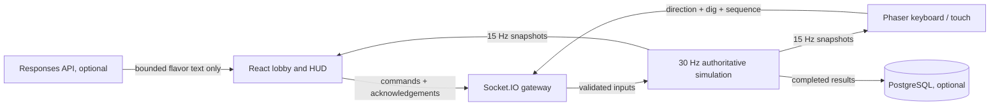

# Architecture and phased development

## Stack assessment

Phaser 3 handles the canvas scene and keyboard inputs; React handles the page, lobby and HUD. They communicate through typed state references rather than rebuilding the Phaser instance on each snapshot. TypeScript shares the state and geometry definitions across browser and server. Vite builds and lazy-loads the island after entering a match.

Express and Socket.IO run in a persistent Node.js process. This matches the proposed stack and supports six players without requiring a distributed system. Use PostgreSQL only for completed results. Writing every movement tick into SQL would add latency without helping a short-lived match.

Render is the first deployment target. A single service serves both the built frontend and sockets, with one public HTTPS origin. Netlify or Vercel can serve `dist/client` separately with `VITE_SERVER_URL` at build time and `CLIENT_ORIGIN` on the backend. Ordinary frontend hosting functions are not the match simulation host.

## Data flow

## Room lifecycle

`lobby → countdown → playing → finished → lobby`

1. A cryptographically generated six-character code identifies a room. The alphabet excludes confusing I, O, 0 and 1. Generation checks for live-code collisions.
2. A new member receives a random player UUID and a 72-character bearer session secret. Only that member receives the secret in its acknowledgement.
3. Players select unique cosmetic characters and mark ready. Only the connected captain can start, with at least two ready, connected members and no unready connected members.
4. A three-second server countdown precedes the match. The server controls the deadline, positions, pickups, traps, power-up expiry and score changes.
5. The server ends the match at its deadline before processing any more rewards. Clients compute the same score ranking; equal top scores are explicitly presented as a shared win.
6. The captain can return the room to readiness. New members can join the lobby for the next round. Disconnects transfer captaincy to a connected member.

## Authority and network behavior

Input is `{x, y, dig, seq}`. Zod rejects unknown fields, non-finite numbers, values outside −1…1 and invalid sequences. Diagonal movement is normalized; the server caps movement delta, checks island and rock collision, and expires inputs after 350 ms. A client never supplies its position, score, reward amount, clock, collision result or winner.

The single-threaded simulation consumes each collectible once, preventing simultaneous claim duplication. Pickups and traps are resolved using server positions. Mystery rewards use server-side cryptographic randomness. A mission bonus has a server-owned completion flag.

The socket gateway enforces a 4 KB message cap, a per-connection event budget, a separate command budget, six-member capacity, 500-room ceiling and same-origin/explicit-origin handshake validation. Hidden chest positions are excluded from snapshots until discovery. Browsers render names and AI text as text, never HTML. Bearer secrets are never included in public snapshots.

Clients send input every 50 ms. The server simulates at 30 Hz and broadcasts at 15 Hz. Phaser interpolates toward server positions, providing smooth remote movement. This version deliberately has no client prediction, lag compensation or rollback; benchmark on the intended internet regions before adding those features.

## Reconnection and cleanup

Session data lives in sessionStorage, so separate tabs can represent separate players while a refresh retains identity. On socket reconnect, the client sends its room, player ID and secret; the server validates the reservation, preserves score and invalidates an older socket for that identity. Clients receive a complete snapshot after reattachment.

Disconnected input is cleared immediately. A lobby reservation expires after 45 seconds. Active-match players remain in final rankings even if they leave; they can no longer move or collect. Empty rooms are deleted, and rooms with no connected explorers expire after five minutes. An explicit leave clears the tab's session. Server restarts remove all live rooms, including reconnect reservations.

## Phases and acceptance gates

| Phase | Architecture and implementation | Acceptance gate |
|---|---|---|
| 1. Foundation | Shared TypeScript contracts; React shell; Phaser scene; Express service | Typecheck and build succeed |
| 2. Rooms | Random codes, six slots, unique characters, ready state, captain controls | Capacity and unauthorized-start tests |
| 3. Match | Fixed tick, server movement/collision, treasure claims, rewards, traps, mission, timer | Engine movement, race, deadline and scoring tests |
| 4. Resilience | Secret-backed resume, input expiry, captain transfer, reset | Real-socket reconnect and rematch tests |
| 5. Presentation | Responsive home/lobby/HUD, art, animations, touch controls | Six browser contexts plus mobile checks and visual review |
| 6. Release | Built-service deployment, optional SQL and AI, README and submission copy | Public hosting access, deployed multiplayer smoke test, provider integrations |

Implemented phases are recorded in `TESTING.md`; phase 6 is not complete until a real public deployment has been verified.

## Future milestones

Add multiple mission templates and islands; production metrics and structured logs; persist-result retry/outbox support; per-IP edge throttling and admission control; physical mobile and network impairment tests; richer authored sprite sheets and audio with mute controls; optional spectator mode. Before scaling beyond one process, assign each room to exactly one simulation owner. A Socket.IO Redis adapter distributes packets but does not itself distribute authoritative game state. Add durable room ownership and failover separately.
