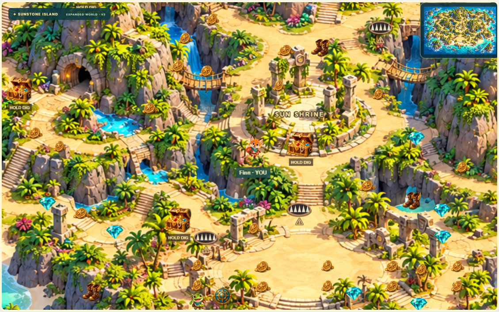

# Treasure Rush 2.0 — Sunstone Expedition

Real-time multiplayer treasure hunting for 2–6 friends, with an illustrated mountain island, ocean coves, ancient ruins and a shared three-minute race for treasure.

**Game URL:** https://treasure-rush-i2co.onrender.com/

**[Open the source code](treasure-rush-source/treasure-rush)** · **[V2 features, tests and deployment guide](treasure-rush-source/treasure-rush/docs/V2-UPGRADE.md)**

After Render deploys this commit, the match title reads **Sunstone Island** and the map badge **EXPANDED WORLD · V2**. If you see the earlier green island, wait for the deployment to become Live, refresh and create a new room.



## What's new

- A 2560 × 1600 painted mountain-and-ocean world, follow camera and minimap.
- Illustrated characters, ornate treasure chests, coins, diamonds, pearls and power-ups.
- Three contracts, pickup combos up to ×1.75, a dash ability and timed excavation.
- Gold Rush, a moving storm, a 200-point Sun Relic race and Final Fortune events.
- Magnets, shields and boots; optional ocean ambience and reward sounds.
- Keyboard and touch controls, real six-player rooms, reconnect and rematch.

## Run locally

```sh
git clone https://github.com/rajakotid007/treasure-rush.git
cd treasure-rush/treasure-rush-source/treasure-rush
npm ci --include=dev
npm run dev
```

Open http://localhost:3000 in two tabs. Create a room, join using its code, mark both ready, and start as captain. Move with WASD/arrows, hold Space to dig while stationary, and press Q/Shift to dash. Mobile players use the on-screen controls.

## Validation

The V2 production build and TypeScript checks passed. All **20 engine/network tests** and **3 Playwright scenarios** passed, including six independent browser sessions, keyboard dash, shared scoring, reconnect, rematch and mobile movement. The built local production service passed a six-client WebSocket smoke test. Production dependency audit: **0 vulnerabilities**. Public V2 smoke testing follows deployment.

```sh
npm test
npm run build
npm run test:e2e
npm run test:deployed -- https://treasure-rush-i2co.onrender.com
```

## Architecture and scope

TypeScript, React, Phaser 3, Express and Socket.IO. The server controls movement, collision, treasure ownership, scores, missions, event scheduling, cooldowns and match timing. The browser sends input only. Character abilities are equal.

Run one Node instance. Rooms are in memory and do not survive server restarts. The illustrated terrain uses simplified collision volumes for major cliffs. Physical-device and adverse-network testing remain follow-up checks. PostgreSQL and OpenAI modules are optional and await live provider verification. The current multiplayer game requires neither paid AI calls nor player accounts.

AI assistance was used for architecture, code, generated artwork, automated testing and deployment troubleshooting. The owner configured GitHub/Render and playtested V1 with a friend. Font licenses are bundled under `public/fonts`; generated art briefs are recorded in `docs/ART-V2.md`.
